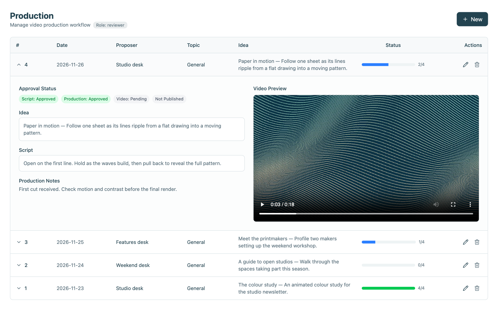
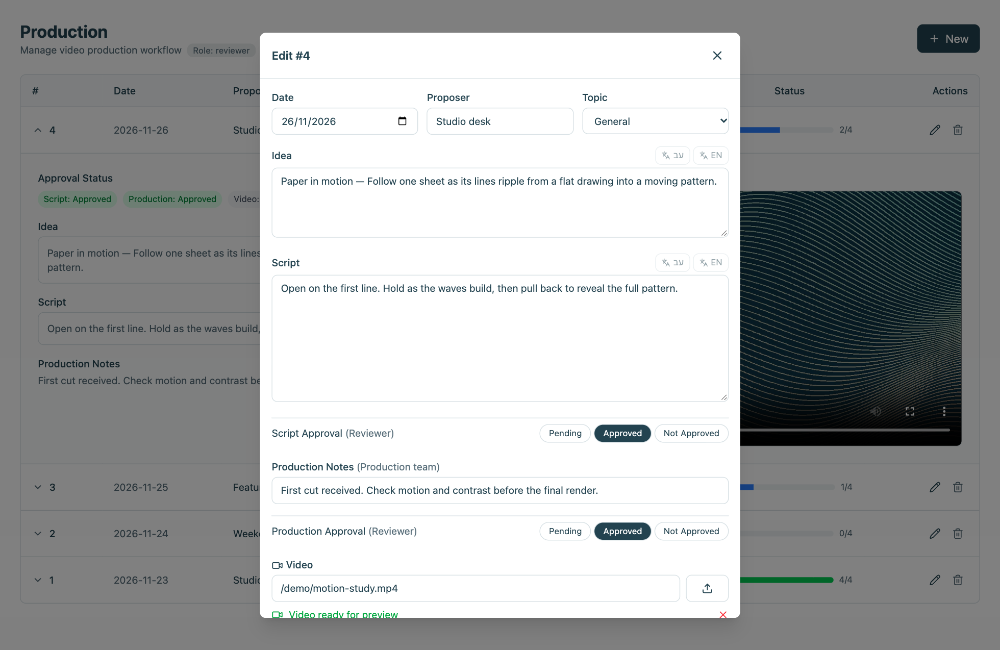

# Production Desk

Follow a video from the pitch to the final cut. Open a production to see the idea, script, notes, approval decisions and playable footage in the same record.

[](docs/production.png)

## Run locally

With Docker Compose installed, run:

```sh
git clone https://github.com/Dror-Bengal/production-desk.git
cd production-desk
docker compose up --build -d
```

Open [Production Desk on your computer](http://localhost:18788). The first launch creates four fictional productions and includes a short motion study. The production workflow runs without cloud credentials.

## Try a production

1. Expand **Paper in motion**. Play the clip and compare the script, production and video approval badges.
2. Choose **New**. Enter an idea and a proposer, add the script, and choose **Create**.
3. Edit the new record. Add production notes, then upload an MP4, WebM or MOV (up to 250 MiB), or paste a link to externally hosted footage.
4. Record each approval and save. The progress bar counts three approval decisions marked **Approved** plus the **Published** distribution flag. Set that flag after distribution has happened.
5. Reload the page and reopen the production. Edits and uploaded footage persist across restarts.

[](docs/editor.png)

## Data and roles

This standalone edition uses the original React production screen. SQLite stores records and a local media directory holds the uploads. Both live in the Compose volume mounted at `/data`. To stop the desk and keep the volume, use `docker compose down`.

The local desk opens in **reviewer** mode, with permission to approve and record distribution. For a team-editing session, run `DESK_ROLE=team docker compose up -d`. Team edits to existing ideas and scripts are flagged for review. The **publisher** role can record distribution. The API enforces the selected role for the whole local instance. A version check prevents an older open editor from overwriting a newer save.

## Optional translation

To translate an idea or script into English or Hebrew, set `GEMINI_API_KEY` and `GEMINI_MODEL` in your shell and run `docker compose up -d` again. A click on a translation button sends the selected field to the configured model. Translation stays disabled until both values are set.

## Source and checks

- [Original production interface](web/src/Production.tsx)
- [Record, video and translation API](server/app.py)
- [SQLite storage and demo records](server/records.py)

Run the automated workflow checks inside the running container:

```sh
docker compose exec desk python -m unittest -v test_workflow
```

The tests use temporary databases and a local response for the optional translation provider.

## License

Nayto’s code is distributed under the [MIT License](LICENSE). Third-party software and media retain their respective terms.
